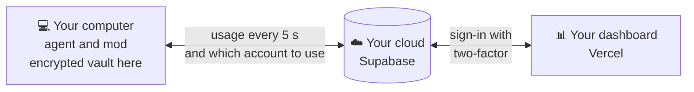

<div align="center">


<br/>

<a href="#-install"></a>
<a href="https://reveza.ia.br/en"></a>
<a href="CHANGELOG.md"></a>

<a href="README.md"></a>
<a href="#-support-the-project"></a>
<a href="https://chat.whatsapp.com/GpWGlonYkLm9R3wMF6FquB"></a>

<br/><br/>

**Reveza AI** switches your Claude Code account before the limit, so the work does not stop.<br/>
You connect your accounts once; it follows each one's usage, switches near the end and the session goes on on the new account.<br/>
Logins stay encrypted on your computer, and the dashboard lives in your own cloud.

🌐 **Project website: [https://reveza.ia.br/en](https://reveza.ia.br/en)**

🌐 [Português](README.md) · **English**

</div>

<br/>

## 😮‍💨 The problem

If you use Claude Code all day, you know these three moments:

- **The limit hits at the worst time.** The 5-hour window runs out in the middle of a refactor, a deploy or an agent running overnight. Everything stops, and the context is left half done.
- **Switching accounts by hand breaks the flow.** Sign out, sign in to the other account, open the session again and explain everything once more. Several times a day.
- **Nobody knows which account has room left.** With several accounts and several people, nobody sees which one is running out, what each delivered or who is using it right now.

## 🔁 With Reveza

| Without Reveza | With Reveza AI |
|---|---|
| The session stops at 100% and you only find out then | Switches before the limit: warns at 90% and switches at 95% |
| Sign out, sign in to the other account and explain the context again | Open sessions keep going, already on the new account |
| The agent running overnight dies at the limit | The unattended session resumes on the next account by itself |
| Account passwords shared over chat | Each login encrypted on your computer; the cloud stores it without being able to read it |
| The bigger plan's account lands on any computer | Each computer can have its preferred account, used whenever it is free |
| Changing the model by hand after every account switch | Each account with its own model, written to the computer at the switch |
| Long `git status` and `grep` output filling the conversation | Lean output, optional: read commands arrive shorter and the account goes further |
| A spreadsheet to guess which account still has room | A dashboard with usage, cost and a forecast of when each account runs out |
| Everyone on the team sorting it out alone | A team with roles, alerts and the history of every switch |

Works with the accounts you already have. On every switch the computer plays a sound (you can turn it off).

<br/>

## 🖥️ The dashboard

<div align="center">

<br/>
<sub><b>Overview</b>: each computer's account, the 5-hour and weekly windows, and what needs attention.</sub>
<br/><br/>


<br/>
<sub><b>Automatic switching</b>: only at the limit, by threshold or rotating, with order, reserve and schedule. <b>Usage</b>: tokens and equivalent cost by day, account, model and project.</sub>
<br/><br/>


<br/>
<sub><b>On the phone</b>: the dashboard installs on the home screen. Screenshots from demo mode, with example accounts.</sub>
</div>

<br/>

## ⚙️ How it works



1. **Connect your accounts.** The official sign-in for each account, once, on your computer. Reveza never asks for an account password.
2. **It follows the usage.** The agent reads how much of the 5-hour window and of the week each account has used; the cloud picks the next one by the rule you set.
3. **Switches before the limit.** Near the end, the computer switches the account and the session continues where it stopped. If you want, an alert tells you what happened.

The computer only calls the cloud: no open port, no tunnel. Without internet, it keeps the current account and does not switch.

<br/>

## 📥 Install

The installer's first step asks for your language: Portuguese (Brazil) or English (United States). `--idioma en`
skips the question and goes straight to English (with `--sim` there is no question and it stays in Portuguese, unless
you pass `--idioma en`):

```bash
npx github:dantaspaulo/reveza --idioma en
```

It asks and sets everything up: checks the computer, installs the agent and the mod, creates your cloud on Supabase,
deploys the dashboard on Vercel (with your own domain, if you want), connects the accounts, sets up alerts and runs a
final check. The steps count from 1 to the total of your path. When each token is needed, the page to create it opens
in your browser by itself (when there is a screen; the address is also printed in the terminal), and the Supabase and
Vercel tokens are **not stored** anywhere (unless you turn on the [full update](#-updating), which keeps them encrypted). Automatic switching starts on, before the limit (warns at 90%, switches at
95%): change it in the dashboard, under **Auto switch**. Importing from another manager (`--importar`) keeps its
settings.

| You need | |
|---|---|
| 🟢 **Node 20.19 or newer** | on macOS, Windows or Linux, including a headless VPS |
| 🪟 **On Windows** | `npx github:` needs [Git](https://git-scm.com/download/win); without it, use the release package: `npx https://github.com/dantaspaulo/reveza/archive/refs/tags/v0.6.3.tar.gz` |
| 🧡 **Claude Code** | installed on each computer that will rotate accounts |
| ☁️ **Supabase and Vercel** | free accounts are enough; without them, use `--sem-nuvem` |
| 🌐 **A domain** | optional: without one, the dashboard lives at `<project>.vercel.app`, free and with HTTPS ([details](#-dashboard-address)) |

<details>
<summary><b>Every installer option</b></summary>

<br/>

| Option | What for |
|---|---|
| `--ligar` | joins one more computer to an existing installation: asks for the dashboard's access code and shows the code to type on the computer that already uses Reveza |
| `--atualizar` | updates agent, mod, database and dashboard; accounts, usage and settings stay |
| `--sem-nuvem` | this computer only: agent, mod and accounts, no online dashboard |
| `--demo` | the dashboard with example data, no cloud, no account touched |
| `--sombra` | next to another account manager, switching nothing (port 7789) |
| `--importar <folder>` | copies accounts and usage from another manager; the source does not change |
| `--doctor` | checks the installation: agent, service, cloud, dashboard and security headers |
| `--desinstalar` | removes the service and the mod; logins, usage, vault key and the computer in the cloud stay (to remove it for good, revoke the computer in the dashboard) |
| `--dominio accounts.mydomain.com` | the dashboard on your subdomain, at install time or later with `--atualizar`; `--dominio vercel` goes back to the Vercel address |
| `--idioma en` | questions in English |
| `--sim` | no questions (reads `SUPABASE_ACCESS_TOKEN`, `VERCEL_TOKEN`, `REVEZA_ADMIN_EMAIL`, `REVEZA_ADMIN_SENHA`, `REVEZA_SUPABASE_REF` and `REVEZA_DOMINIO` from the environment) |

</details>

### 🌐 Dashboard address

If you choose nothing, the dashboard lives at Vercel's free address, `https://<project>.vercel.app`, already with
HTTPS. To use a subdomain of yours (`accounts.mydomain.com`), choose it during the install or run later, on the computer
that created the installation:

```bash
npx github:dantaspaulo/reveza --atualizar --dominio accounts.mydomain.com
```

The installer shows the record Vercel asks for, to create wherever the domain lives (Cloudflare, GoDaddy, Namecheap,
Route 53 or any other DNS): a `CNAME` named after the subdomain (e.g. `accounts`) pointing to the value it shows
(usually `cname.vercel-dns.com`), or an `A` record to `76.76.21.21` for a root domain. Vercel issues the HTTPS
certificate by itself, and the Vercel address starts redirecting to yours. On Cloudflare, keep the proxy off (grey
cloud, "DNS only"). To go back to the Vercel address: `--atualizar --dominio vercel` (the domain stays attached to the
Vercel project until you remove it there).

<br/>

## ➕ A new computer: the code shows up on it

1. In the dashboard: **Computers → Link new computer → Generate the access code**. Choose which computer the window opens on.
2. On the new computer, run the command the dashboard shows (`npx ... --ligar`) and paste the access code (`rvzc_...`) when it asks. That code only lets the new computer **ask** to join: it does not open the vault.
3. The new computer shows a 12-character code in large letters (`XXXX-XXXX-YYYY`). On the computer that already uses Reveza, which plays a sound and opens a window, type that code and click **Release**. No screen (server, VPS, SSH): run `reveza ligar XXXX-XXXX-YYYY` there. The last 4 are a secret that never leaves the new computer's screen: do not send a picture of the code to anyone.
4. Done: the vault key travels encrypted for the new computer only, and it joins with the accounts.

No secret goes through the screen: a screenshot or a copied access code does not open the vault. The request is valid
for 10 minutes, one new computer at a time (two at once are both refused), and three wrong codes refuse the request.
Codes from before 0.2.0 (`rvzl_`, which carried the vault phrase) no longer work: generate a new one in the dashboard.
The computer that lets the new one in needs version 0.2.0 or newer.

<details>
<summary><b>Emergency: a computer already linked that lost the vault key</b></summary>

<br/>

On a computer that has the key, `reveza ligar --mostrar-frase` shows 6 words, valid for 10 minutes. On the one that lost
the key (and is still linked to the cloud), `reveza ligar --frase` asks for the words. The phrase opens the vault during
those 10 minutes: on screen only, never by chat or e-mail. A new computer does not use the phrase; it joins through the
code it shows.

</details>

<br/>

## 🧑‍💻 Day to day

```bash
reveza status            # account in use, usage per account, next switch
reveza trocar a@example.com
reveza uso --csv         # usage log as a spreadsheet
reveza som desligar      # turns off the switch sound (som ligar, som testar)
reveza resumo 300k       # how many tokens before the conversation is summarized (default 180k; resumo desligar)
reveza doctor            # diagnostics
reveza contas conectar b@example.com   # connects an account from the terminal
```

Inside sessions, **`/reveza`** shows the accounts, and the status line shows the account in use and the 5-hour window.

**Conversation summary:** on accounts that are not 20x, Claude Code summarizes the conversation near 180k tokens (its
own default for Opus 5.5 is 1 million). Conversations kept for days went past 600k, got stuck with "Prompt is too
long", and not even `/compact` helped; and every message sends the whole conversation, so a smaller one makes the
account last longer. On 20x accounts, Claude Code's default stays. Your own `/autocompact` takes precedence.

**Model per account:** in the dashboard, under **Accounts**, when editing an account, the **Assistant model** field:
`opus`, `sonnet`, `haiku`, `opusplan` or another name, as in `/model` (`[1m]` at the end asks for the 1M window). When a
computer switches to that account, the agent writes the model to the `model` key of `~/.claude/settings.json`, and
sessions opened afterwards start on it. Whoever changes it with `/model` keeps theirs until the next account switch.
With **Don't change**, the agent puts back the previous value if it was the one that changed it, and otherwise leaves
the key alone. Nothing else in the file changes.

**Lean output:** off by default. Under **Computers**, on each computer's card, the **Lean output** switch makes that
computer's mod trim the output of `git status`, `git diff` and `git show`, `ls`, `find`, `grep` and `rg` and `tree`
before it enters the conversation (open sessions pick it up too, in under a minute). Out go the `git status` hints, the
diff's `index` line, the `total` and the `.` and `..` of `ls -l`, and the file name repeated on every `grep` and `find`
line: lines from the same file come together, under it. A listing longer than 300 lines, and a diff file longer than
200, is cut with a note saying how many lines were left out. Only a simple command is trimmed (a leading `cd folder &&`
is fine); with a pipe, `;`, another `&&` or a redirect, the output passes whole, so the same command with `| cat` at the
end shows everything. Machine formats (`--porcelain`, `-z`, `-print0`) and stderr stay as they came. Measured on
13/10/2026, on 13 read commands in three real repositories: 34% less text overall (from 119,800 to 79,333 characters);
`git status` 51% to 59%, `find` with subfolders 48%, `grep -rn` 17% to 20%, `ls -la` 6% to 14% and `git diff` 1% to 3%
(a diff has little to drop before the cut).

**Connecting an account:** the computer opens the official sign-in in a **private window** of its browser (Chrome,
Edge, Brave, Chromium or Firefox), without the account already open in it (people with several Chrome profiles ended up
in the wrong account). Sign in and that's it: the sign-in finishes on its own. On another device, or the window did not
open? In the dashboard or in `reveza contas conectar`, open the sign-in address, sign in and paste the code the page
shows. On Windows, the sign-in opens in the default browser.

**Dashboard closed:** you can close it. The agent, running as a service on the computer, switches the account, and the
cloud sends the notices: every alert (on your phone, email, Telegram, webhook), including the stopped-computer one
and the one for each account switch, arrives with the dashboard closed. No notice depends on the open tab. The
browser's memory saving (in Chrome and Edge, for example) pauses or reloads an idle tab: the dashboard says it is
reconnecting and reads the cloud again when you come back. To keep it from reloading, add the dashboard address to the
sites that always stay active, in the browser's performance options.

<details>
<summary><b>🔌 API and webhooks</b></summary>

<br/>

Create a key under **Integrations** in the dashboard, with the scopes you need.

```bash
curl -H "Authorization: Bearer rvz_..." https://<project>.supabase.co/functions/v1/api/estado
curl -H "Authorization: Bearer rvz_..." "https://<project>.supabase.co/functions/v1/api/uso?dias=7"
curl -X POST -H "Authorization: Bearer rvz_..." -d '{"computador":"<id>","conta":"<id>"}' https://<project>.supabase.co/functions/v1/api/trocar
```

Webhooks carry `X-Reveza-Assinatura: sha256=<HMAC-SHA256 of the body with your secret>`. Check it before trusting:

```js
const expected = "sha256=" + crypto.createHmac("sha256", secret).update(rawBody).digest("hex");
```

</details>

<br/>

## 🔄 Updating

The order is always the same: **the cloud first, then the functions and the dashboard, and the computers last**, one at
a time. It all lives under **Computers → Updates**, in the dashboard.

- **The cloud (the database)** updates itself, **with no token at all**: the **Update the cloud** button asks, and the
  cloud downloads the newest official published version, applies only the missing migrations (each one whole or
  nothing, in a transaction) and records them. It only accepts an official version of the repository, newer than its
  own.
- **The cloud functions and the dashboard** need the Supabase and Vercel tokens. Without the full update, when a version
  changes them the dashboard shows the manual step: run `npx github:dantaspaulo/reveza --atualizar` on the computer that
  created the installation. With the **full update** on, a computer of the installation (the first one that is on and
  calm, on any system) publishes them by itself; the old dashboard stays online until the new one is published.
- **The computers** update through the buttons (**Check for updates**, **Update**, **Update all**) or by themselves, and
  a computer only moves to a new version once the cloud is on it.

**Update by itself** applies to everything, in the same order: **Off** (the default, buttons only), **Overnight** (3 to
5 a.m.) or **As soon as it comes out**. If a step fails, the next ones stop, the dashboard shows why and an alert goes
out (the "Automatic update stopped" event, on the channels you choose under Alerts).

<details>
<summary><b>Full update: the tokens kept encrypted (optional, off by default)</b></summary>

<br/>

```bash
reveza atualizacao-completa ligar      # asks for both tokens without showing them
reveza atualizacao-completa status
reveza atualizacao-completa desligar   # or Turn off, in the dashboard
```

The installer also offers it at the end (default: no). The tokens go to the cloud **encrypted with the vault key**, the
same one that protects the logins: the cloud stores text it cannot read, and only a computer of the installation opens
it. They are never in clear text on disk, in a log or in an event. The cost: **whoever has a computer of the installation
gets these tokens**. So prefer short-reach tokens with an expiry:

- **Vercel** ([tokens](https://vercel.com/account/tokens)): scoped to the dashboard's team only, with an expiry;
- **Supabase** ([tokens](https://supabase.com/dashboard/account/tokens)): with an expiry if the page offers one, from an
  account that only has the Reveza organization (the token reaches everything the account reaches).

Turning it off removes the tokens from the cloud; to revoke access for good, delete the tokens in Supabase and Vercel.
The computer that publishes builds the dashboard locally (with the free React Bits downloaded there, as in the install)
and sends only the result to your Vercel.

</details>

<br/>

## 🔐 Security

- **The cloud stores, but cannot read.** Each login is encrypted on the computer (AES-256-GCM). The vault key lives only in the system keychain; Supabase receives ciphertext and Vercel not even that.
- **Least privilege.** No server key outside Supabase. Every table has row-level security, every change goes through a function that checks the role and writes the audit log. Each computer has its own identity, revocable on its own.
- **Dashboard sign-in** by invitation only, strong password, two-factor for admins (and the option to require it from everyone).
- **Published dashboard** with a strict CSP, HSTS and no secret in the browser.
- **Updates without secrets where none are needed.** The cloud applies its own migrations without a token, and only
  from an official published version. The tokens that publish functions and dashboard are only kept if you turn on the
  full update, and then encrypted with the vault key.
- **Audited** with [Cloudflare's security audit skill](https://github.com/cloudflare/security-audit-skill): the confirmed findings were fixed, and the repository guard refuses secrets and personal data on every commit.

The whole architecture is in [docs/ARQUITETURA.en.md](docs/ARQUITETURA.en.md).

<br/>

## 🤝 Contribute

Questions, news and help: join the [Reveza group on WhatsApp](https://chat.whatsapp.com/GpWGlonYkLm9R3wMF6FquB) (in Portuguese).

Found a bug or have an idea? [Open an issue](https://github.com/dantaspaulo/reveza/issues). Want to change the code?
Pull requests are welcome, translations included. If Reveza saved you from a stop at the limit, leave a ⭐.

```bash
git config core.hooksPath .githooks         # the guard: refuses secrets, personal data and React Bits components
cd agente && npm ci && npm test             # agent: switching, vault, ownership, fake cloud
cd nuvem && npm ci && npm test              # database (PGlite with the migrations) and functions
npm ci && npm test                          # installer and guards
cd painel && npm ci && npm run react-bits && npm run dev   # dashboard at http://localhost:5173/?demo=1
npm run auditoria                           # npm audit on every lockfile
node scripts/versao.mjs lancar X.Y.Z        # new version: write the CHANGELOG first; bumps everything, tag and release
```

<br/>

## 💛 Support the project

Reveza is free and open source. If it saved you from stops at the limit, a contribution helps keep up development,
security reviews and new versions.

<div align="center">

<a href="https://www.asaas.com/000/c/fymw4xl2f5b3n05b"></a>
<a href="https://wa.me/?text=Reveza%20AI%20switches%20your%20Claude%20Code%20account%20before%20the%20limit%20and%20the%20session%20goes%20on.%20Free%20and%20open%20source%3A%20https%3A//reveza.ia.br/en"></a>

</div>

- **R$ 100 through Asaas**, by Pix, card or boleto (Brazilian reais): [support the project](https://www.asaas.com/000/c/fymw4xl2f5b3n05b).
- **Larger amounts, straight by Pix**, any amount you like. Key (phone): `84988942848`.
- **Know someone who keeps hitting the limit?** [Send them Reveza on WhatsApp](https://wa.me/?text=Reveza%20AI%20switches%20your%20Claude%20Code%20account%20before%20the%20limit%20and%20the%20session%20goes%20on.%20Free%20and%20open%20source%3A%20https%3A//reveza.ia.br/en).

<sub>Contributions go to PSD Software, which maintains the project. Supporting is optional: Reveza stays free and open for everyone.</sub>

<br/>

## 💰 Costs and licenses

- **Supabase and Vercel:** the free plans are enough to start. Your Claude accounts stay yours, as they are.
- **React Bits:** the dashboard's free components are MIT + Commons Clause and are not in the repository; the installer downloads them on your machine and checks each one.
- **Reveza AI:** MIT. Use it, adapt it and share it.

> Each person is responsible for the use of their own accounts and for the terms of the AI service they use. Reveza AI
> is an independent project, not affiliated with Anthropic. Claude and Claude Code are trademarks of Anthropic.

<br/>

<!-- quem-fez -->
<div align="center">

## 👋 Who made it

<a href="https://github.com/dantaspaulo">
<picture>
  <source media="(max-width: 700px)" srcset="https://raw.githubusercontent.com/dantaspaulo/dantaspaulo/main/assets/papeis-celular.svg" />
  
</picture>
</a>

**Paulo Sérgio Dantas** builds businesses with AI.<br/>
<sub>Reveza was born for my own Claude Code accounts. I also opened <a href="https://github.com/dantaspaulo/claquete">Claquete.ai</a>, the video studio Claude operates.</sub>

<br/>

<a href="https://github.com/dantaspaulo"></a>
<a href="https://paulosdantas.adv.br"></a>
<a href="https://www.linkedin.com/in/paulosdantas/"></a>
<a href="mailto:contato@paulosdantas.adv.br"></a>

<br/><br/>

<sub>Using Reveza with your team? Tell me.</sub>


</div>
<!-- /quem-fez -->
