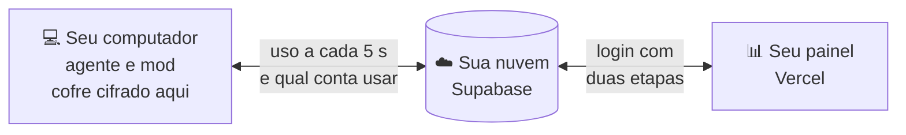

<div align="center">


<br/>

<a href="#-instalar"></a>
<a href="https://reveza.ia.br"></a>
<a href="CHANGELOG.md"></a>

<a href="README.en.md"></a>
<a href="#-apoie-o-projeto"></a>
<a href="https://chat.whatsapp.com/GpWGlonYkLm9R3wMF6FquB"></a>

<br/><br/>

**Reveza AI** troca a conta do Claude Code antes do limite, para o trabalho não parar.<br/>
Você conecta as suas contas uma vez; ele acompanha o uso de cada uma, troca perto do fim e a sessão segue na conta nova.<br/>
Os logins ficam cifrados no seu computador, e o painel mora na sua própria nuvem.

🌐 **Site do projeto: [https://reveza.ia.br](https://reveza.ia.br)**

🌐 **Português** · [English](README.en.md)

</div>

<br/>

## 😮‍💨 O problema

Quem usa o Claude Code o dia todo conhece estes três momentos:

- **O limite chega na pior hora.** A janela de 5 horas acaba no meio de uma refatoração, de um deploy ou de um agente rodando de madrugada. Tudo para, e o contexto fica pela metade.
- **Trocar de conta na mão quebra o ritmo.** Sair, entrar na outra conta, abrir a sessão de novo e explicar tudo outra vez. Várias vezes por dia.
- **Ninguém sabe qual conta ainda tem fôlego.** Com várias contas e várias pessoas, ninguém vê qual está no fim, quanto cada uma rendeu nem quem está usando agora.

## 🔁 Com o Reveza

| Sem o Reveza | Com o Reveza AI |
|---|---|
| A sessão para em 100% e você descobre na hora | Troca antes do limite: avisa em 90% e troca em 95% |
| Sair, entrar na outra conta e explicar o contexto de novo | As sessões abertas seguem, já na conta nova |
| O agente que rodava de madrugada morre no limite | A sessão sem ninguém retoma sozinha na conta seguinte |
| Senha de conta passada por mensagem | Cada login cifrado no seu computador; a nuvem guarda sem conseguir ler |
| A conta do plano maior cai em qualquer computador | Cada computador pode ter a sua conta preferida, usada sempre que estiver livre |
| Trocar o modelo à mão depois de cada troca de conta | Cada conta com o seu modelo, gravado no computador na hora da troca |
| `git status` e `grep` longos enchendo a conversa | Saída enxuta, opcional: os comandos de leitura chegam mais curtos e a conta rende mais |
| Planilha para adivinhar qual conta ainda tem saldo | Painel com uso, custo e previsão de esgotar de cada conta |
| Cada pessoa do time resolvendo no seu canto | Time com papéis, alertas e o histórico de cada troca |

Funciona com as contas que você já tem. A cada troca, o computador faz um som (dá para desligar).

<br/>

## 🖥️ O painel

<div align="center">

<br/>
<sub><b>Visão geral</b>: a conta de cada computador, a janela de 5 horas e da semana, e o que pede atenção.</sub>
<br/><br/>


<br/>
<sub><b>Troca automática</b>: só no limite, por limiar ou em rodízio, com ordem, reserva e agenda. <b>Uso</b>: tokens e custo equivalente por dia, conta, modelo e projeto.</sub>
<br/><br/>


<br/>
<sub><b>No celular</b>: o painel instala na tela inicial. Imagens do modo demonstração, com contas de exemplo.</sub>
</div>

<br/>

## ⚙️ Como funciona



1. **Conecte suas contas.** Login oficial de cada conta, uma vez, no seu computador. O Reveza não pede senha de conta.
2. **Ele acompanha o uso.** O agente lê quanto cada conta já gastou da janela de 5 horas e da semana; a nuvem escolhe a próxima pela regra que você definir.
3. **Troca antes do limite.** Perto do fim, o computador troca a conta e a sessão continua de onde parou. Se quiser, um alerta conta o que aconteceu.

O computador só chama a nuvem: nenhuma porta aberta, nenhum túnel. Sem internet, ele mantém a conta atual e não troca.

<br/>

## 📥 Instalar

```bash
npx github:dantaspaulo/reveza
```

Ele pergunta e monta tudo: confere o computador, instala o agente e o mod, cria a sua nuvem no Supabase, publica o
painel na Vercel (com domínio próprio, se quiser), conecta as contas, configura os alertas e faz uma prova final.
As etapas contam de 1 até o total do seu caminho. Na hora de cada token, a página de criá-lo abre sozinha no navegador
(com tela; o endereço também aparece no terminal), e os tokens do Supabase e da Vercel **não ficam guardados** em lugar
nenhum (a não ser que você ligue a [atualização completa](#-atualizar), que os guarda cifrados). A troca automática já vem ligada, antes do limite (avisa em 90%, troca em 95%): muda no painel, em **Troca
automática**. Quem importa de outro gestor (`--importar`) fica com a configuração de lá.

O instalador começa pelo idioma (português ou inglês); `--idioma pt|en` pula a pergunta. Com `--sim` não há pergunta e
fica em português, salvo `--idioma en`.

| Precisa de | |
|---|---|
| 🟢 **Node 20.19 ou mais novo** | no macOS, no Windows ou no Linux, inclusive numa VPS sem tela |
| 🪟 **No Windows** | o `npx github:` precisa do [Git](https://git-scm.com/download/win); sem ele, use o pacote da versão: `npx https://github.com/dantaspaulo/reveza/archive/refs/tags/v0.7.1.tar.gz` |
| 🧡 **Claude Code** | instalado em cada computador que vai revezar contas |
| ☁️ **Supabase e Vercel** | contas grátis bastam; sem elas, use `--sem-nuvem` |
| 🌐 **Domínio** | opcional: sem ele, o painel fica em `<projeto>.vercel.app`, de graça e com HTTPS ([detalhes](#-endereço-do-painel)) |

<details>
<summary><b>Todas as opções do instalador</b></summary>

<br/>

| Opção | Para quê |
|---|---|
| `--ligar` | liga mais um computador a uma instalação que já existe: pede o código de acesso do painel e mostra o código para digitar no computador que já usa o Reveza |
| `--atualizar` | atualiza agente, mod, banco e painel; contas, uso e configuração ficam |
| `--sem-nuvem` | só neste computador: agente, mod e contas, sem painel online |
| `--demo` | o painel com dados de exemplo, sem nuvem e sem mexer em conta nenhuma |
| `--sombra` | ao lado de outro gestor de contas, sem trocar nada (porta 7789) |
| `--importar <pasta>` | copia contas e uso de outro gestor; a origem não muda |
| `--doctor` | confere a instalação: agente, serviço, nuvem, painel e cabeçalhos de segurança |
| `--desinstalar` | tira o serviço e o mod; logins, uso, chave do cofre e o computador na nuvem ficam (para tirar de vez, revogue o computador no painel) |
| `--dominio contas.meudominio.com` | o painel no seu subdomínio, na instalação ou depois, com `--atualizar`; `--dominio vercel` volta ao endereço da Vercel |
| `--idioma en` | perguntas em inglês |
| `--sim` | sem perguntas (lê `SUPABASE_ACCESS_TOKEN`, `VERCEL_TOKEN`, `REVEZA_ADMIN_EMAIL`, `REVEZA_ADMIN_SENHA`, `REVEZA_SUPABASE_REF` e `REVEZA_DOMINIO` do ambiente) |

</details>

### 🌐 Endereço do painel

Sem escolher nada, o painel fica no endereço gratuito da Vercel, `https://<projeto>.vercel.app`, já com HTTPS. Para usar
um subdomínio seu (`contas.meudominio.com`), escolha na instalação ou rode depois, no computador que criou a instalação:

```bash
npx github:dantaspaulo/reveza --atualizar --dominio contas.meudominio.com
```

O instalador mostra o registro que a Vercel pede, para criar onde o domínio estiver (registro.br, Cloudflare, GoDaddy,
Hostinger, Route 53 ou outro): um `CNAME` com o nome do subdomínio (ex.: `contas`) apontando para o valor que ele
mostra (em geral `cname.vercel-dns.com`), ou um `A` para `76.76.21.21` quando é o domínio raiz. A Vercel emite o
certificado HTTPS sozinha, e o endereço da Vercel passa a redirecionar para o seu. Na Cloudflare, deixe o proxy
desligado (nuvem cinza, "DNS only"). Para voltar ao endereço da Vercel: `--atualizar --dominio vercel` (o domínio segue
ligado ao projeto na Vercel até você tirar lá).

<br/>

## ➕ Computador novo: o código aparece nele

1. No painel: **Computadores → Ligar computador novo → Gerar o código de acesso**. Escolha em qual computador a janela vai abrir.
2. No computador novo, rode o comando que o painel mostra (`npx ... --ligar`) e cole o código de acesso (`rvzc_...`) quando ele pedir. Esse código só deixa o computador novo **pedir** para entrar: ele não abre o cofre.
3. O computador novo mostra, em letras grandes, um código de 12 caracteres (`XXXX-XXXX-YYYY`). No computador que já usa o Reveza, que toca um som e abre uma janela, digite esse código e clique em **Liberar**. Sem tela (servidor, VPS, SSH): rode lá `reveza ligar XXXX-XXXX-YYYY`. Os 4 últimos são segredo e não saem da tela do computador novo: não mande foto do código para ninguém.
4. Pronto: a chave do cofre vai cifrada só para o computador novo, e ele entra já com as contas.

Nenhum segredo passa pela tela: um print ou o código de acesso copiado não abrem o cofre. O pedido vale 10 minutos,
um computador novo por vez (dois ao mesmo tempo são recusados), e o código errado três vezes recusa o pedido. Os códigos
de antes da 0.2.0 (`rvzl_`, que levavam a frase do cofre) não valem mais: gere um novo no painel. O computador que libera
precisa estar na 0.2.0 ou mais nova.

<details>
<summary><b>Emergência: computador já ligado que perdeu a chave do cofre</b></summary>

<br/>

Num computador que tem a chave, `reveza ligar --mostrar-frase` mostra 6 palavras, válidas por 10 minutos. No que perdeu
a chave (e continua ligado à nuvem), `reveza ligar --frase` pede as palavras. A frase abre o cofre nesses 10 minutos: só
na tela, nunca por chat ou e-mail. Computador novo não usa a frase; ele entra pelo código que aparece nele.

</details>

<br/>

## 🧑‍💻 No dia a dia

```bash
reveza status            # conta em uso, uso de cada conta, próxima troca
reveza trocar a@exemplo.com
reveza uso --csv         # registro de uso em planilha
reveza som desligar      # tira o som da troca (som ligar, som testar)
reveza resumo 300k       # perto de quantos tokens a conversa é resumida (de fábrica, 180k; resumo desligar)
reveza doctor            # diagnóstico
reveza contas conectar b@exemplo.com   # conecta uma conta pelo terminal
```

Dentro das sessões, **`/reveza`** mostra as contas, e a linha de status mostra a conta em uso e a janela de 5 horas.

**Resumo da conversa:** nas contas que não são 20x, o Claude Code resume a conversa perto de 180 mil tokens (o
automático dele, no Opus 5.5, é 1 milhão). Conversa de dias passava de 600 mil, travava com "Prompt is too long" e nem o
`/compact` resolvia; e cada mensagem manda a conversa inteira, então conversa menor faz a conta durar mais. Nas contas de
20x fica o automático. Um `/autocompact` seu vale por cima disso.

**Modelo de cada conta:** no painel, em **Contas**, ao editar uma conta, o campo **Modelo do assistente**: `opus`,
`sonnet`, `haiku`, `opusplan` ou outro nome, como no `/model` (`[1m]` no fim pede a janela de 1M). Quando um computador
passa para essa conta, o agente grava o modelo na chave `model` do `~/.claude/settings.json`, e as sessões abertas
depois começam nele. Quem trocar pelo `/model` fica com o seu até a próxima troca de conta. Com **Não mexer**, o agente
devolve o valor que estava antes, se foi ele que mudou, e senão não toca na chave. O resto do arquivo não muda.

**Saída enxuta:** desligada de fábrica. Em **Computadores**, no cartão de cada computador, a chave **Saída enxuta** faz
o mod daquele computador encurtar a saída de `git status`, `git diff` e `git show`, `ls`, `find`, `grep` e `rg` e `tree`
antes de ela entrar na conversa (vale também para as sessões já abertas, em menos de um minuto). Saem as dicas do
`git status`, a linha `index` do diff, o `total` e o `.` e `..` do `ls -l`, e o nome do arquivo repetido em cada linha
do `grep` e do `find`: as linhas do mesmo arquivo vêm juntas, embaixo dele. Listagem com mais de 300 linhas, e arquivo
de diff com mais de 200, é cortada com um aviso de quantas linhas saíram. Só entra um comando simples (um `cd pasta &&`
na frente vale); com pipe, `;`, outro `&&` ou redirecionamento, a saída passa inteira, por isso o mesmo comando com
`| cat` no fim mostra tudo. Formato de máquina (`--porcelain`, `-z`, `-print0`) e o stderr ficam como vieram. Medido em
13/10/2026, em 13 comandos de leitura em três repositórios de verdade: 34% menos texto no total (de 119.800 para 79.333
caracteres); `git status` de 51% a 59%, `find` com subpastas 48%, `grep -rn` de 17% a 20%, `ls -la` de 6% a 14% e
`git diff` de 1% a 3% (o diff quase não tem o que tirar antes do corte).

**Conectar conta:** o computador abre o login oficial numa **janela anônima** do navegador (Chrome, Edge, Brave,
Chromium ou Firefox), sem a conta que já estiver aberta nele (quem tem vários perfis do Chrome caía na conta errada).
Entre na conta e pronto: o login termina sozinho. Está em outro aparelho, ou a janela não abriu? No painel ou no
`reveza contas conectar`, abra o endereço do login, entre na conta e cole o código que a página mostrar. No Windows, o
login abre no navegador padrão.

**Painel fechado:** pode fechar. Quem troca a conta é o agente, que roda como serviço no computador, e quem avisa é a
nuvem: todos os alertas (no celular, e-mail, Telegram, webhook), inclusive o de computador parado e o de cada troca
de conta, chegam com o painel fechado. Nenhum aviso depende da aba aberta. A economia de memória do navegador (no
Chrome e no Edge, por exemplo) pausa ou recarrega a aba parada: o painel avisa que está reconectando e lê a nuvem de
novo quando você volta. Para ele não recarregar, ponha o endereço do painel entre os sites que ficam sempre ativos, nas
opções de desempenho do navegador.

<details>
<summary><b>🔌 API e webhooks</b></summary>

<br/>

Crie uma chave em **Integrações**, no painel, com os escopos que precisar.

```bash
curl -H "Authorization: Bearer rvz_..." https://<projeto>.supabase.co/functions/v1/api/estado
curl -H "Authorization: Bearer rvz_..." "https://<projeto>.supabase.co/functions/v1/api/uso?dias=7"
curl -X POST -H "Authorization: Bearer rvz_..." -d '{"computador":"<id>","conta":"<id>"}' https://<projeto>.supabase.co/functions/v1/api/trocar
```

Os webhooks levam `X-Reveza-Assinatura: sha256=<HMAC-SHA256 do corpo com o seu segredo>`. Confira antes de confiar:

```js
const esperado = "sha256=" + crypto.createHmac("sha256", segredo).update(corpoBruto).digest("hex");
```

</details>

<br/>

## 🔄 Atualizar

A ordem é sempre a mesma: **a nuvem primeiro, depois as funções e o painel, e por último os computadores**, um por vez.
Tudo fica em **Computadores → Atualizações**, no painel.

- **A nuvem (o banco)** se atualiza sozinha, **sem token nenhum**: o botão **Atualizar a nuvem** pede, e a própria nuvem
  baixa a versão oficial mais nova publicada, aplica só as migrações que faltam (cada uma inteira ou nada, numa
  transação) e registra. Ela só aceita versão oficial do repositório e mais nova que a dela.
- **As funções da nuvem e o painel** precisam dos tokens do Supabase e da Vercel. Sem a atualização completa, quando uma
  versão mexe neles o painel mostra o passo manual: rodar `npx github:dantaspaulo/reveza --atualizar` no computador que
  criou a instalação. Com a **atualização completa** ligada, um computador da instalação (o primeiro ligado e calmo, de
  qualquer sistema) publica sozinho; o painel antigo continua no ar até o novo publicar.
- **Os computadores** se atualizam pelos botões (**Verificar atualização**, **Atualizar**, **Atualizar todos**) ou
  sozinhos, e um computador só sobe para uma versão nova quando a nuvem já está nela.

**Atualizar sozinho** vale para tudo, na mesma ordem: **Desligada** (o padrão, só pelos botões), **De madrugada** (das
3h às 5h) ou **Assim que sair**. Se um passo falhar, os seguintes param, o painel mostra o motivo e sai um alerta (o
evento "Atualização sozinha parou", nos canais que você escolher em Alertas).

**O assistente de código** (o Claude Code) também aparece ali, no cartão **Assistente de código**: a versão de cada
computador lado a lado, o **Atualizar** de cada um e o **Atualizar os atrasados**. E a escolha de como ele se atualiza:

- **Do jeito do assistente** (o padrão): o Reveza não mexe. O assistente se atualiza quando uma sessão abre, e um
  computador parado pode ficar atrás.
- **Sempre a mais nova**: cada computador roda a atualização do assistente a cada 6 horas, num momento calmo, mesmo sem
  sessão aberta. Mantém todos na mesma versão.
- **Só pelo painel**: o Reveza desliga a atualização automática do assistente (`DISABLE_AUTOUPDATER` no
  `~/.claude/settings.json`) e a versão só muda pelo Atualizar. Serve para segurar todos numa versão que funciona. Um
  valor que você escreveu à mão nesse arquivo é seu, e o Reveza não mexe nele; a desinstalação devolve o que ele desligou.

Sessões abertas seguem na versão em que começaram; a nova vale nas próximas. Instalação pelo apt, dnf ou apk precisa de
root para atualizar, e o painel mostra o erro.

<details>
<summary><b>Atualização completa: os tokens guardados cifrados (opcional, desligada de fábrica)</b></summary>

<br/>

```bash
reveza atualizacao-completa ligar      # pede os dois tokens sem mostrar na tela
reveza atualizacao-completa status
reveza atualizacao-completa desligar   # ou Desligar, no painel
```

A instalação também oferece no fim (padrão: não). Os tokens vão para a nuvem **cifrados com a chave do cofre**, a mesma
dos logins: a nuvem guarda um texto que não lê, e só um computador da instalação abre. Nunca ficam em claro em disco,
log ou evento. O que isso custa: **quem tiver um computador da instalação passa a ter esses tokens**. Por isso, prefira
tokens de alcance curto e com validade:

- **Vercel** ([tokens](https://vercel.com/account/tokens)): escopo só no time do painel e com validade;
- **Supabase** ([tokens](https://supabase.com/dashboard/account/tokens)): com validade, se a página oferecer, e de uma
  conta que só tenha a organização do Reveza (o token alcança tudo o que a conta alcança).

Desligar tira os tokens da nuvem; para tirar o acesso de vez, apague os tokens no Supabase e na Vercel. Quem publica
compila o painel no próprio computador (com o React Bits grátis baixado ali, como na instalação) e manda só o resultado
para a sua Vercel.

</details>

<br/>

## 🔐 Segurança

- **A nuvem guarda, mas não lê.** Cada login é cifrado no computador (AES-256-GCM). A chave do cofre mora só no chaveiro do sistema; o Supabase recebe texto cifrado e a Vercel nem isso.
- **Menor privilégio.** Nenhuma chave de servidor fora do Supabase. Toda tabela tem segurança de linha, toda mudança passa por uma função que confere o papel e grava a auditoria. Cada computador tem identidade própria, revogável sozinha.
- **Login do painel** só por convite, senha forte, duas etapas para quem administra (e a opção de exigir de todos).
- **Painel publicado** com CSP restrita, HSTS e nenhum segredo no navegador.
- **Atualização sem segredo onde não precisa.** A nuvem aplica as próprias migrações sem token, e só de versão oficial
  publicada. Os tokens que publicam funções e painel só existem guardados se você ligar a atualização completa, e
  então cifrados com a chave do cofre.
- **Auditado** com a [skill de auditoria de segurança da Cloudflare](https://github.com/cloudflare/security-audit-skill): os achados foram corrigidos, e a trava do repositório recusa segredo e dado pessoal em todo commit.

A arquitetura inteira está em [docs/ARQUITETURA.md](docs/ARQUITETURA.md).

<br/>

## 🤝 Contribuir

Dúvidas, novidades e ajuda: entre no [grupo do Reveza no WhatsApp](https://chat.whatsapp.com/GpWGlonYkLm9R3wMF6FquB).

Achou um bug ou tem uma ideia? [Abra uma issue](https://github.com/dantaspaulo/reveza/issues). Quer mexer no código?
Pull requests são bem-vindos, inclusive traduções. Se o Reveza te poupou de uma parada no limite, deixe uma ⭐.

```bash
git config core.hooksPath .githooks         # a trava: recusa segredo, dado pessoal e componente do React Bits
cd agente && npm ci && npm test             # agente: troca, cofre, posse, nuvem falsa
cd nuvem && npm ci && npm test              # banco (PGlite com as migrações) e funções
npm ci && npm test                          # instalador e travas
cd painel && npm ci && npm run react-bits && npm run dev   # painel em http://localhost:5173/?demo=1
npm run auditoria                           # npm audit em todas as travas
node scripts/versao.mjs lancar X.Y.Z        # versão nova: escreva a CHANGELOG antes; sobe tudo, tag e release
```

<br/>

## 💛 Apoie o projeto

O Reveza é grátis e de código aberto. Se ele te poupou de paradas no limite, uma contribuição ajuda a manter o
desenvolvimento, a revisão de segurança e as versões novas.

<div align="center">

<a href="https://www.asaas.com/000/c/fymw4xl2f5b3n05b"></a>
<a href="https://wa.me/?text=O%20Reveza%20AI%20troca%20a%20conta%20do%20Claude%20Code%20antes%20do%20limite%20e%20a%20sess%C3%A3o%20continua.%20Gr%C3%A1tis%20e%20de%20c%C3%B3digo%20aberto%3A%20https%3A//reveza.ia.br"></a>

</div>

- **R$ 100 pelo Asaas**, no Pix, no cartão ou no boleto: [apoiar o projeto](https://www.asaas.com/000/c/fymw4xl2f5b3n05b).
- **Valores maiores, direto no Pix**, com o valor que quiser. Chave (celular): `84988942848`.
- **Conhece alguém que vive batendo no limite?** [Mande o Reveza no WhatsApp](https://wa.me/?text=O%20Reveza%20AI%20troca%20a%20conta%20do%20Claude%20Code%20antes%20do%20limite%20e%20a%20sess%C3%A3o%20continua.%20Gr%C3%A1tis%20e%20de%20c%C3%B3digo%20aberto%3A%20https%3A//reveza.ia.br).

<sub>As contribuições vão para a PSD Software, que mantém o projeto. Apoiar é opcional: o Reveza segue grátis e aberto para todo mundo.</sub>

<br/>

## 💰 Custos e licenças

- **Supabase e Vercel:** os planos grátis bastam para começar. As contas do Claude continuam suas, do jeito que já são.
- **React Bits:** os componentes grátis do painel são MIT + Commons Clause e não vêm no repositório; o instalador baixa na sua máquina e confere cada um.
- **Reveza AI:** MIT. Use, adapte e compartilhe.

> Cada pessoa responde pelo uso das próprias contas e pelos termos do serviço de IA que usa. O Reveza AI é um projeto
> independente, sem vínculo com a Anthropic. Claude e Claude Code são marcas da Anthropic.

<br/>

<!-- quem-fez -->
<div align="center">

## 👋 Quem fez

<a href="https://github.com/dantaspaulo">
<picture>
  <source media="(max-width: 700px)" srcset="https://raw.githubusercontent.com/dantaspaulo/dantaspaulo/main/assets/papeis-celular.svg" />
  
</picture>
</a>

**Paulo Sérgio Dantas** constrói negócios com IA.<br/>
<sub>O Reveza nasceu para as minhas próprias contas do Claude Code. Também abri o <a href="https://github.com/dantaspaulo/claquete">Claquete.ai</a>, o estúdio de vídeo que o Claude opera.</sub>

<br/>

<a href="https://github.com/dantaspaulo"></a>
<a href="https://paulosdantas.adv.br"></a>
<a href="https://www.linkedin.com/in/paulosdantas/"></a>
<a href="mailto:contato@paulosdantas.adv.br"></a>

<br/><br/>

<sub>Usa o Reveza no seu time? Me conta.</sub>


</div>
<!-- /quem-fez -->
